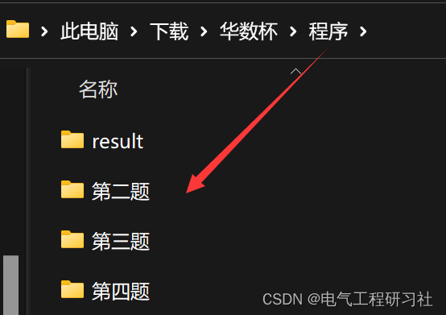

# "Hua Shu Cup" Modeling Learning Thoughts (Matlab & Python Code Implementation)

1. Overview of the Product Technology Requirements
2. Read the full text and code demonstration
3. Comprehensive summary
1. Overview of the product technology requirements
Abstract:
The melt blowing nonwoven technology plays a crucial role in the textile industry due to its short process flow and high production efficiency. However, melt blowing nonwoven materials have issues such as poor compression recovery elasticity. To improve their performance, scholars have proposed the insertion melt blowing method. This paper mainly studies the impact of the melt blowing insertion method on the process parameters, structural variables, and product performance of the material, as well as the cross-impact between the process parameters, structural variables, and product performance, and the interaction between internal parameters and the optimization of performance. The paper conducts in-depth research through establishing correlation models, prediction models, and target optimization models.
For problem one, regarding the changes in the insertion structure variable and product performance, an entropy increase rate model is established through Python for visualization analysis. Then, based on the Pearson correlation coefficient method, specific variable correlation analysis is conducted on the comparison data before and after the insertion of structural variables and product performance; for the impact of the insertion rate on these changes, since there are too many variables and the data is relatively complex, compared to the Pearson correlation coefficient method, the Spearman correlation coefficient method has a higher degree of inclusiveness for parameter outliers, and its correlation coefficient is not easily affected by outliers. Therefore, a Spearman correlation model is established for multivariate correlation analysis, and the final results can be presented in the form of heat maps for easy analysis.
For problem two, this is a prediction problem. Firstly, based on the known data, a multiple nonlinear regression equation is used to solve the prediction model of process parameters and structural variables. Secondly, considering the occurrence of many variables and model residual problems, the isolation random forest prediction method is used to compare with the predicted model. Finally, the predicted results are compared and analyzed, and the obtained predictions are filled into the table. The comparative results of the two algorithms show that their data values are very close or almost equal, indicating that the prediction model has excellent predictive performance and is more accurate in prediction values.
Regarding Problem 3, regarding the relationship between structural variables and product performance multivariates. Firstly, establish a typical correlation model to analyze the relationship between the two. Secondly, establish a nonlinear regression fitting model for the mathematical relationship between the two. For structural variables between... The relationship between product performance. Kendall correlation model established for variables. For the highest filtration efficiency, This problem is an optimization problem. Maximize filtering efficiency as the objective function. Process parameters, Structural variables are constraints. Considering the correlation between product performance, Filter resistance and permeability should also be considered as constraints.Establish a single-objective multi-constraint optimization model, utilize SPSS for the typical correlation model, and employ a hybrid particle swarm with chaos butterfly optimization algorithm for the single-objective optimization model. The optimal solution is obtained by the algorithm when the acceptance distance is 21.09694 cm and the hot air speed is 810.32506 r/min, resulting in a filtration efficiency of 89.81246%.
In response to question four, compared with the single-objective optimization of question three, this optimization problem is a dual-objective optimization. The objective function is set as maximizing filtration efficiency while minimizing filtration resistance; according to the problem statement, process parameters and structural variables are set as constraints, considering the correlation between product performance, and permeability is also considered as a constraint. Due to the complexity of dual-objective optimization, in order to find the global optimal solution, this paper adopts the multiverse optimization algorithm to solve the dual-objective optimization model and uses MATLAB to plot the frontier solutions. Finally, it was found that when the acceptance distance is 36.2051cm and the hot air velocity is 817.303r/min, the highest filtration efficiency is 52.0768%, and the minimum filtration resistance is: 18.7408Pa.
Keywords: Entropy increment rate method, Spearman correlation coefficient method, Isolation random forest prediction model, Mixed Particle Swarm Optimization Chaos Butterfly optimization algorithm, Multiverse optimization algorithm, Bi-dimensional nonlinear regression fitting model.  
1. Restatement of the problem
1.1 Problem Background
In recent years, due to the outbreak of COVID-19, there has been a continuous increase in the demand for masks in our country, making them an essential part of daily life. Therefore, there is a certain quality requirement for these masks to effectively protect our health. One important raw material in the production process of masks is meltblown nonwoven materials, which are highly filtering and easy to produce, cost-effective, and lightweight. These characteristics have made them favored by many domestic and international mask manufacturers.However, it also has a drawback due to the fine fibers of melt-blown nonwoven materials. This results in insufficient compression recovery during the production process of masks, leading scientists to propose the intercalation melt-blown method. This involves inserting short fibers such as polyester (PET) into the melt-blown fiber stream during the preparation of polypropylene (PP) melt-blown nonwoven materials, resulting in "Z-shaped" structured intercalated melt-blown nonwoven materials. However, in actual production, this method involves numerous process parameters and their mutual influence, along with complex issues such as intercalation airflow, making it challenging to establish a model that links these parameters to structural variables, structural variables to product performance.
1.2 Problem Presentation (Rephrase the Question)
Melt blown nonwoven materials are an important raw material for mask production, with excellent filtration performance. Their simple production process, low cost, and lightweight characteristics have attracted widespread attention from domestic and foreign enterprises. However, due to the very fine fibers of melt blown nonwoven materials, they often fail to ensure their performance due to poor compression recovery during use. Therefore, scientists have developed intercalated melt blowing methods, which involve inserting fibers such as polyester (PET) short fibers into the melt blown fiber stream during the preparation of polypropylene (PP) melt blown nonwoven materials, resulting in "Z-shaped" structured intercalated melt blown nonwoven materials.
The preparation process of intercalated melt blown nonwoven materials involves many parameters, and there is an interaction between them. After intercalation, the complexity becomes even greater. Therefore, determining the structural variables (thickness, porosity, compression recovery) through process parameters (receiving distance and hot air velocity) and then determining the final product performance (filter resistance, filter efficiency, permeability) based on these structural variables has become more complex. If we can establish a relationship model between the process parameters and the structural variables, as well as the structural variables and the product performance, it will help to establish a theoretical foundation for the establishment of product performance regulation mechanisms. Please refer to relevant literature for professional background, research topic data, and answer the following questions:
Question 1: Please study the changes in structural variables and product performance after intercalation, and analyze whether the intercalation rate affects these changes.
Question 2: Please study the relationship between process parameters and structural variables. Table 1 provides 8 combinations of process parameters. Please fill in the predicted structural variable data in Table 1 and represent it in a table format.
Table 1 Results of Question 2
Receiving distance (cm)  
Hot air speed (r/min)  
Thickness (mm)  
Porosity (%)  
Compression recovery rate (%)  
38  
850  
33  
950  
28  
1150  
23  
1250  
38  
1250  
33  
1150  
28  
950  
23  
850
Issue 3: Please investigate the relationship between structural variables and product performance, as well as the relationships between structural variables and product performance. In conjunction with question two, determine when the filtration efficiency of the product will reach its highest when the process parameters are set to what extent?

Issue 4: In reality, the production of products requires consideration of various conditions and requirements. For example, the receiving distance is unlikely to be greater than 100 cm, and the heat air speed is also unlikely to exceed 2000 r/min. According to application requirements, the thickness should not exceed 3 mm, and the compression rebound rate should not fall below 85%. Additionally, to prevent the occurrence of rapid decline in filtration efficiency due to large particle clogging of pores caused by high filtration resistance in melt blown nonwoven filter materials, the product needs to simultaneously pursue high filtration efficiency and low filtration resistance. Please determine when the filtration efficiency can be maximized while striving for minimal filtration resistance.

II. Problem Analysis
2.1 Analysis of Issue One
In order to address the changes in structural variables and product performance before and after insertion, we first need to process the raw data set. We extract a comparison data set between before and after insertion from the original data set. Based on the entropy increase rate model, we calculate the change rate of each parameter. Finally, we use Python to draw graphs of the changes in structural variables and product performance. Through this analysis, if most samples show an increase in entropy greater than 0, it can be preliminarily judged that the insertion melt blowing method can improve structure or enhance performance. Conversely, if the graph is very close to 0, it can be judged that the method has no effect on structure or performance. Secondly, Pearson correlation coefficient method is used for specific univariate correlation analysis of structural variables and product performance before and after insertion.If the Pearson correlation coefficient r > 0, The intercalation before and after the insertion presents a positive correlation. It can indicate that the intercalation melt blowing method can improve the material structure and enhance product performance. Moreover, the closer r approaches 1, the better the effect. On the contrary, Then it presents a negative correlation. The insertion layer melt blowing method will destroy the material structure. Reduce product performance. When r = 0, Shows that the parameters before and after insertion are uncorrelated. The plug-in layer is responsible for the structural variables. The product performance is unaffected. Finally, the final conclusion is drawn by combining the results of entropy increase and Pearson correlation coefficient.
Regarding the question of whether intercalation rate affects these changes. The multivariate variance analysis method can be used to test whether the intercalation rate has a significant impact on these parameter changes. Additionally, the differences between parameters in the data can be calculated first. Use the results as the change value. The change was analyzed using the Spearman correlation coefficient for multivariate correlation analysis. Since Spiegelman's requirements for parameters are not strict, The Spearman correlation coefficient method will be employed to measure the impact of intercalation rate on parameter changes. And due to the numerous variables. The calculation results can be presented in the form of a heat map for easy analysis.
2.2 Analysis of Problem Two
For the problem of predicting structural variables based on known process parameters, This is a prediction problem based on known data. Consider adopting the nonlinear regression prediction method. Firstly, the relationship model between process parameters and structural variables should be obtained. Establish a bivariate nonlinear regression model to fit the power parameters and structural variables data known in Table 1. A predictive model of structural variable based on power parameters is obtained. Conduct residual analysis on the prediction model to assess its feasibility for prediction. Finally, the model is solved by MATLAB to obtain the predicted values of relevant parameters. Furthermore, The power parameters and structural variables can be utilized. Model verification through the isolation random forest prediction method. Accredit the model's excellent performance.
2.3 Analysis of Problem Three
Addressing the relationship between structural variables and product performance, as well as the relationships between structural variables and product performance.
Regarding relevance, the first step is to utilize SPSS tools for a canonical correlation analysis of structural variables and product performance to measure their relationship. The conclusions are drawn by analyzing the standardized and non-standardized canonical correlation coefficients, as well as the variance ratio. The correlation between structural variables and product performance is then analyzed using multivariate Kendall correlation coefficients through SPSS tools.
In terms of models, considering the relationship between the process parameters and structural variables as mentioned in question two, a nonlinear regression fitting model can be established by establishing a relationship model between product performance and structural variables.
In response to the issue of achieving the highest filtration effect for the product. This is an optimization problem. The objective function is to maximize the filtering effect. Process parameters, The structural variables are constraints. Considering the correlation between product performance, Filter resistance and permeability should also be considered as constraints. Establish a single-objective optimization model. This paper intends to use a heuristic search algorithm with fast convergence and high precision, combined with the Chaotic Butterfly Optimization Algorithm, to find the optimal solution for this model.
2.4 Analysis of Question Four
Utilizing the relationship model between product performance and structural variables from Problem Three, a mathematical model for filter efficiency and resistance to filtration is established using multivariate linear regression. The optimization model aims for maximum filter efficiency and minimum resistance to filtration, with process parameters, structural variables, and permeability as constraints. The dual-objective optimization model is formulated. The Multiverse Optimization Algorithm has high precision in solution and avoids local optima, which are desirable features. This algorithm will be employed to solve the dual-objective optimization model.
2. Read the entire document and code demonstrations ​​Edit
Editor
Editor
Need a paper and all program points here: 2022 Hua Shu Cup Paper and Program (C Question)
3. Summary of the full text
In this paper, the impacts among process parameters, structural variables and product performance as well as their internal relationships are analyzed by establishing entropy increase rate model and correlation models (Pearson correlation model, Spearman correlation model, Canonical correlation model and Kendall correlation model).
In response to process parameters, Prediction problem between structural variables and product performance. This article establishes a multivariate nonlinear regression prediction model. The multivariate linear regression prediction model and the isolated random forest prediction model are used to obtain the relationship between variables. And solve the prediction problem with the mathematical model of relation.
In response to the issue of optimizing product performance, This paper establishes single-objective optimization model and double-objective optimization model. The Chaotic Butterfly Algorithm of Mixed Particle Swarm Optimization. Multiverse optimization algorithm solves the model. A global optimal solution is obtained.
From the above all model solving results, Process parameters The structure variables and product performance are not only interdependent, The internal parameters of them themselves also have an interactive impact. For example, the thickness between structural variables. Porosity Compression recovery When the thickness increases, It also affects the porosity and compressive rebound. Insertion melt blowing method for the structural variables of melt blown nonwoven materials. The product performance has a certain degree of positive impact. However, the higher the intercalation rate is not always better. The correlation of each parameter with the intercalation rate is different. For example, the thickness is positively correlated. The porosity is negatively correlated.Establish a multi-objective optimization model based on product performance requirements, determining our objective function and corresponding constraints, such as the last question being acceptable distance not exceeding 100Cm, hot air speed not exceeding 2000rmin, thickness not exceeding 3mm, compression recovery rate not lower than 85% etc., to help establish the product performance regulation mechanism.
​  

## Images

<!-- PAYMENT_BLOCK -->

## Get this dataset

- Payment link (Stripe): [Buy now](https://buy.stripe.com/3cs8yP7sY87d0vu9AB)
- Payment QR code: 

<!-- /PAYMENT_BLOCK -->
